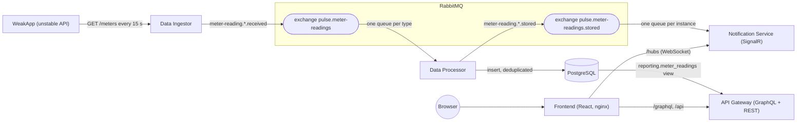
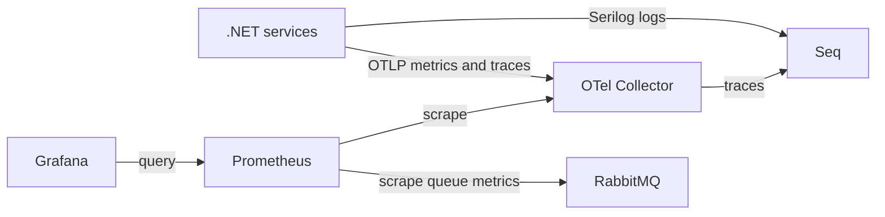

# PulseAnalytics

[](https://github.com/Ovsyannikov345/PulseAnalytics/actions/workflows/data-ingestor.yml)
[](https://github.com/Ovsyannikov345/PulseAnalytics/actions/workflows/data-processor.yml)
[](https://github.com/Ovsyannikov345/PulseAnalytics/actions/workflows/api-gateway.yml)
[](https://github.com/Ovsyannikov345/PulseAnalytics/actions/workflows/notification-service.yml)
[](https://github.com/Ovsyannikov345/PulseAnalytics/actions/workflows/frontend.yml)

PulseAnalytics collects smart-home meter readings (motion, energy, air quality) from
[WeakApp](https://github.com/nantonov/WeakApp), a deliberately unstable external API. The readings go through
RabbitMQ into PostgreSQL. They are served over GraphQL and REST, and pushed live to a React dashboard over
SignalR. Four .NET 10 microservices, the frontend and all the infrastructure start with one `docker compose` command.

**Contents:** [What's inside](#whats-inside) ·
[Architecture](#architecture) ·
[Quick start](#quick-start) ·
[URLs](#urls) ·
[Configuration](#configuration) ·
[API](#api-at-a-glance) ·
[Frontend](#frontend) ·
[Local development](#local-development) ·
[Testing](#testing) ·
[CI/CD](#cicd) ·
[Observability](#observability) ·
[Code quality](#code-quality) ·
[Git workflow](#git-workflow)

## What's inside

```text
PulseAnalytics/
├── services/
│   ├── DataIngestor/          Polls WeakApp and publishes every reading to RabbitMQ
│   ├── DataProcessor/         Validates readings, stores them in PostgreSQL, publishes "stored" events
│   ├── ApiGateway/            GraphQL + REST (CSV export) API over the stored readings
│   └── NotificationService/   Pushes stored readings to browsers over SignalR
├── frontend/                  React + TypeScript dashboard (Vite), served by nginx
├── deploy/
│   ├── docker-compose.yml     The whole system: WeakApp, RabbitMQ, PostgreSQL, services, frontend, observability
│   ├── .env.example           Template for deploy/.env (credentials, image tags, host ports)
│   ├── deploy.sh              Mock deployment script used by the CD stage
│   ├── otel-collector/        OpenTelemetry Collector config
│   ├── prometheus/            Prometheus scrape config
│   └── grafana/               Provisioned datasource and dashboards
└── .github/workflows/         One CI/CD pipeline per service and frontend, plus reusable workflows
```

Each service is self-contained, as if it lived in its own repository. It has its own solution (`<Service>.slnx`),
`Directory.Build.props`, `.editorconfig`, `Dockerfile`, unit and integration test projects, and pipeline. The services
share no code and no build files. The monorepo only keeps everything in one place for review.

## Architecture



1. **Data Ingestor** polls `GET /meters` every 15 seconds through a resilience pipeline: timeouts, retries with
   jittered backoff, and full-body buffering. It skips malformed items and publishes one event per reading to the
   `pulse.meter-readings` topic exchange, using publisher confirms.
2. **Data Processor** consumes one durable queue per reading type. It validates each reading with FluentValidation and
   stores it in PostgreSQL, deduplicated by message id. It then publishes a `*ReadingStored` event to
   `pulse.meter-readings.stored`. The processor owns the database: it applies the EF Core migrations at startup and
   exposes the `reporting.meter_readings` view as the read contract for other services.
3. **API Gateway** is a read-only HotChocolate GraphQL API over that view, with filtering, cursor paging, latest values
   and statistics by time and location. It also has a REST CSV export documented in Swagger.
4. **Notification Service** binds an exclusive queue per instance to the stored-events exchange and broadcasts every
   stored reading to connected browsers through the SignalR hub `/hubs/readings`.
5. **Frontend** is a React dashboard served by nginx. nginx also proxies `/graphql`, `/api` and `/hubs` to the
   backend, so the browser talks to one origin.

The services exchange message contracts as NuGet packages owned by the producer:
[`PulseAnalytics.DataIngestor.Contracts`](services/DataIngestor/DataIngestor.Contracts) (consumed by the processor) and
[`PulseAnalytics.DataProcessor.Contracts`](services/DataProcessor/DataProcessor.Contracts) (consumed by the
notification service).

| Component            | Tech                                                                                     |
| -------------------- | ---------------------------------------------------------------------------------------- |
| Data Ingestor        | .NET 10 worker, `Microsoft.Extensions.Http.Resilience` (Polly), RabbitMQ.Client          |
| Data Processor       | .NET 10 worker, EF Core + Npgsql, FluentValidation, RabbitMQ.Client                      |
| API Gateway          | ASP.NET Core 10, HotChocolate 16, EF Core (read-only), FluentValidation, Swashbuckle UI |
| Notification Service | ASP.NET Core 10, SignalR, RabbitMQ.Client                                                |
| Frontend             | React 19, TypeScript, Vite, Apollo Client, `@microsoft/signalr`, Recharts, nginx         |
| WeakApp              | Built from a pinned commit of the upstream repo                                          |
| Message broker       | RabbitMQ 4.1                                                                             |
| Database             | PostgreSQL 18                                                                            |
| Logs and traces      | Serilog, Seq                                                                             |
| Metrics              | OpenTelemetry Collector, Prometheus, Grafana                                             |

All services log with Serilog, handle errors globally (ProblemDetails in the gateway, GraphQL error filter), and
validate their options at startup, so a missing setting stops the service immediately with a clear error.

## Quick start

**Prerequisites:** Docker with Compose v2, and internet access on the first run. Compose builds WeakApp from a pinned
GitHub commit and pulls the service images from Docker Hub.

1. Create `deploy/.env` from the template. The defaults work as they are.

   ```powershell
   Copy-Item deploy/.env.example deploy/.env
   ```

   ```bash
   cp deploy/.env.example deploy/.env
   ```

2. Start everything from the repository root:

   ```bash
   docker compose -f deploy/docker-compose.yml up -d
   ```

3. Wait until every container is `healthy`. This takes about 40 seconds on a warm machine; the first run also
   downloads the images.

   ```bash
   docker compose -f deploy/docker-compose.yml ps
   ```

4. Open the dashboard at <http://localhost:5100>. The first readings arrive about 20 seconds after the ingestor starts
   (a 5 s startup delay, then a poll every 15 s). WeakApp fails often on purpose, so some polls bring nothing.

Stop the system with `docker compose -f deploy/docker-compose.yml down`. Add `-v` to also delete all data (database,
broker, logs, metrics) and reset the first-start credentials.

## URLs

With the default ports:

| What                                 | URL                                                                                                                                                                | Login                                            |
| ------------------------------------ | ------------------------------------------------------------------------------------------------------------------------------------------------------------------ | ------------------------------------------------ |
| Dashboard                            | <http://localhost:5100>                                                                                                                                            |                                                  |
| GraphQL endpoint and Nitro IDE       | <http://localhost:5103/graphql>                                                                                                                                    |                                                  |
| Swagger UI (REST)                    | <http://localhost:5103/swagger>                                                                                                                                    |                                                  |
| CSV export example                   | <http://localhost:5103/api/readings/export?From=2026-11-23T00:00:00Z&To=2026-11-24T00:00:00Z&Types=Energy&Locations=Kitchen>                                       |                                                  |
| SignalR hub                          | `ws://localhost:5104/hubs/readings` (also `ws://localhost:5100/hubs/readings` through nginx)                                                                       |                                                  |
| RabbitMQ management                  | <http://localhost:15672>                                                                                                                                           | `RABBITMQ_USER` / `RABBITMQ_PASSWORD`            |
| Seq (logs and traces)                | <http://localhost:5341>                                                                                                                                            | `admin` / `SEQ_ADMIN_PASSWORD`                   |
| Grafana                              | <http://localhost:3000>                                                                                                                                            | `GRAFANA_ADMIN_USER` / `GRAFANA_ADMIN_PASSWORD`  |
| Prometheus                           | <http://localhost:9090>                                                                                                                                            |                                                  |
| WeakApp                              | <http://localhost:5000/health>, `/meters` with header `X-Api-Key: <WEAKAPP_API_KEY>`                                                                               |                                                  |
| Health checks                        | `http://localhost:{5100,5101,5102,5103,5104}/health`                                                                                                               |                                                  |

The frontend also serves `/graphql` and `/api` on port 5100, so the dashboard needs no other port.

## Configuration

### `deploy/.env`

Compose reads `deploy/.env` and stops with `Set <VAR> in deploy/.env` when a required value is missing.
[`deploy/.env.example`](deploy/.env.example) documents every variable.

| Variable                                                                                                                | Required | Purpose                                                                                     |
| ----------------------------------------------------------------------------------------------------------------------- | -------- | ------------------------------------------------------------------------------------------- |
| `WEAKAPP_API_KEY`                                                                                                       | yes      | Key the ingestor sends in `X-Api-Key`. It must match the key built into WeakApp; keep it as is. |
| `RABBITMQ_USER`, `RABBITMQ_PASSWORD`                                                                                    | yes      | Broker user for RabbitMQ and every service.                                                 |
| `POSTGRES_USER`, `POSTGRES_PASSWORD`, `POSTGRES_DB`                                                                     | yes, `POSTGRES_DB` optional | Database user for the processor and gateway; the database name defaults to `pulse_analytics`. |
| `SEQ_ADMIN_PASSWORD`, `SEQ_API_KEY`                                                                                     | yes, key optional | Seq `admin` password; an optional ingestion API key.                               |
| `GRAFANA_ADMIN_USER`, `GRAFANA_ADMIN_PASSWORD`                                                                          | yes      | Grafana login.                                                                              |
| `DATA_INGESTOR_TAG`, `DATA_PROCESSOR_TAG`, `API_GATEWAY_TAG`, `NOTIFICATION_SERVICE_TAG`, `FRONTEND_TAG`                | no       | Docker Hub image tags; default `latest`. CI also publishes `sha-<short commit>`.            |
| `*_PORT`                                                                                                                | no       | Host ports; the defaults are listed in `.env.example`.                                      |

The RabbitMQ, PostgreSQL, Seq and Grafana credentials are written into their Docker volumes on first start. To change
them later, recreate the volumes with `docker compose -f deploy/docker-compose.yml down -v`.

### Service settings

Each service reads `appsettings.json` and environment variables, where `Section__Key` overrides `Section:Key`. Compose
sets only connection settings; everything else has working defaults. Some useful ones:

| Service        | Setting                                                                                                                                         | Default            |
| -------------- | ----------------------------------------------------------------------------------------------------------------------------------------------- | ------------------ |
| Data Ingestor  | `MeterPollingWorker__PollingPeriodInSeconds`, `MeterPollingWorker__StartupDelayInSeconds`                                                       | 15, 5              |
| Data Ingestor  | `WeakApp__Resilience__TotalTimeoutInSeconds`, `__AttemptTimeoutInSeconds`, `__MaxRetryAttempts`, `__RetryBaseDelayInSeconds`                    | 20, 5, 2, 1        |
| API Gateway    | `Cors__AllowedOrigins__0` (only needed when the frontend runs on another origin)                                                                | none               |
| All            | `Seq__ServerUrl`, `Seq__ApiKey`, `OpenTelemetry__OtlpEndpoint` (log and telemetry export is off when the URL is empty)                           | empty              |

### Run a locally built image

Compose runs the images CI published to Docker Hub. To try a local change, build the image under the same name with
the tag `local`, then point compose at it:

```bash
docker build -t ilyaovsyannikov/pulse-analytics-data-processor:local services/DataProcessor
```

Then set `DATA_PROCESSOR_TAG=local` in `deploy/.env` and run `docker compose -f deploy/docker-compose.yml up -d` again.
The image names are `pulse-analytics-data-ingestor`, `-data-processor`, `-api-gateway`, `-notification-service` and
`-frontend`; the build contexts are `services/<Service>` and `frontend`.

## API at a glance

### GraphQL (`/graphql`)

The schema is strongly typed and committed as
[`schema.graphql`](services/ApiGateway/ApiGateway.Api/GraphQL/schema.graphql). A unit test fails when the schema
changes without that file being updated. Nitro, the GraphQL IDE, opens when you visit `/graphql` in a browser.

| Query                                                          | What it returns                                                                                                                          |
| -------------------------------------------------------------- | ---------------------------------------------------------------------------------------------------------------------------------------- |
| `readings(filter, first, after)`                               | Stored readings, newest first, as a cursor connection (50 per page by default, 100 at most). Filter by types, locations and time range. |
| `latestReadings(filter)`                                       | The newest reading of every meter (type and location).                                                                                   |
| `readingCounts(filter, groupBy)`                               | Reading counts, grouped by `TYPE` and/or `LOCATION`.                                                                                     |
| `energyStatistics`, `airQualityStatistics`, `motionStatistics` | Average, minimum and maximum (motion: activity ratio) grouped by `LOCATION` and/or `TIME`, in buckets from `MINUTE` to `DAY` on a fixed UTC grid. Ranges up to 31 days and 1000 buckets. |

`MeterReading` is an interface implemented by `EnergyReading`, `AirQualityReading` and `MotionReading`. Example:

```graphql
query {
  latestReadings(filter: { locations: [KITCHEN] }) {
    type
    location
    receivedAt
    ... on EnergyReading { energy }
    ... on AirQualityReading { co2 pm25 humidity }
    ... on MotionReading { motionDetected }
  }
  energyStatistics(
    filter: { from: "2026-11-23T00:00:00Z", to: "2026-11-24T00:00:00Z" }
    groupBy: [LOCATION, TIME]
    bucket: HOUR
  ) {
    location
    bucketStart
    samples
    energy { average minimum maximum }
  }
}
```

Invalid arguments return GraphQL errors with codes. Queries are limited to depth 8 and 15 seconds.

### REST (`/api`)

`GET /api/readings/export` streams the matching readings as CSV. It is documented in Swagger at `/swagger`.

| Parameter   | Required | Format                                                                                                             |
| ----------- | -------- | ------------------------------------------------------------------------------------------------------------------ |
| `From`      | yes      | Inclusive start, ISO 8601 with an offset, e.g. `2026-11-23T00:00:00Z`                                              |
| `To`        | yes      | Exclusive end, at most 7 days after `From`                                                                         |
| `Types`     | no       | `AirQuality`, `Energy`, `Motion`; repeat for several                                                               |
| `Locations` | no       | `Kitchen`, `LivingRoom`, `Bedroom`, `Garage`, `Office`, `Corridor`; repeat for several                             |

Invalid parameters return `400` with ProblemDetails.

### SignalR (`/hubs/readings`)

The hub is server-to-client only. Each stored reading is sent to all clients as `ReadingStored` with one JSON object,
discriminated by `type`:

```json
{ "type": "Energy", "id": "019a91b2-4c6e-7d13-9a58-3e7f2b6c1d02", "location": "Office", "receivedAt": "2026-11-17T10:15:30.123+00:00", "energy": 845.62 }
```

Motion messages carry `motionDetected`; air quality messages carry `co2`, `pm25` and `humidity`. The wire format is
pinned by snapshot tests in
[`NotificationService.UnitTests`](services/NotificationService/tests/NotificationService.UnitTests/Api/Hubs/Readings/Snapshots).

## Frontend

| Page      | Route        | Shows                                                                                                                         |
| --------- | ------------ | ----------------------------------------------------------------------------------------------------------------------------- |
| Overview  | `/`          | The latest value of every meter, summary tiles, per-location cards and 24-hour trends; refreshes every 30 s                    |
| Live      | `/live`      | The newest sample per meter, updated in real time over SignalR, with connection status                                          |
| Analytics | `/analytics` | Average, minimum and maximum by location and time bucket: energy, air quality with warnings, a motion heatmap                   |
| Readings  | `/readings`  | Every stored sample with filters and paging, plus CSV download                                                                  |

The UI is built with React 19, Apollo Client, `@microsoft/signalr` and Recharts, styled with CSS Modules, without a
component library. Every view handles loading, empty and error states and adapts to narrow screens. GraphQL types are
generated from the gateway's committed schema with GraphQL Code Generator.

In the container, nginx serves the static build and proxies `/graphql` and `/api` to the gateway and `/hubs`
(WebSocket) to the notification service. Their addresses come from `API_GATEWAY_URL` and `NOTIFICATION_SERVICE_URL`,
so no backend URL is built into the bundle.

## Local development

Requirements: [.NET 10 SDK](https://dotnet.microsoft.com/download), Node.js 26 (see
[`frontend/.nvmrc`](frontend/.nvmrc)) and Docker.

### Frontend

With the compose stack running, the Vite dev server proxies `/graphql`, `/api` and `/hubs` to `localhost:5103` and
`localhost:5104`. Override the targets with the `API_GATEWAY_URL` and `NOTIFICATION_SERVICE_URL` environment
variables.

```bash
cd frontend
npm ci
npm run dev        # http://localhost:5173
npm run codegen    # regenerate GraphQL types after a schema change
```

### Services

Start only the infrastructure, then run the services you work on with `dotnet run`. The Development settings send logs
to Seq and telemetry to the collector on `localhost`.

```bash
docker compose -f deploy/docker-compose.yml up -d weakapp rabbitmq postgres seq otel-collector prometheus grafana
```

The connection settings have no defaults, so set them as environment variables first. The values below match
`deploy/.env.example`.

| Service              | Required settings                                                                                            | Local URL               |
| -------------------- | ------------------------------------------------------------------------------------------------------------ | ----------------------- |
| Data Ingestor        | `WeakApp__BaseUrl=http://localhost:5000`, `WeakApp__ApiKey`, `RabbitMq__Host=localhost`, `RabbitMq__UserName`, `RabbitMq__Password` | <http://localhost:5124> |
| Data Processor       | `RabbitMq__*` as above, `Database__ConnectionString=Host=localhost;Port=5432;Database=pulse_analytics;Username=user;Password=password` | <http://localhost:5227> |
| API Gateway          | `Database__ConnectionString` as above                                                                         | <http://localhost:5103> |
| Notification Service | `RabbitMq__*` as above                                                                                        | <http://localhost:5104> |

For example, in PowerShell:

```powershell
$env:WeakApp__BaseUrl = "http://localhost:5000"
$env:WeakApp__ApiKey = "supersecret"
$env:RabbitMq__Host = "localhost"
$env:RabbitMq__UserName = "user"
$env:RabbitMq__Password = "password"
dotnet run --project services/DataIngestor/DataIngestor.Api
```

Start order doesn't matter. The processor and notification service wait for their exchanges to appear, and the
processor creates the database schema at startup, which the gateway reads.

## Testing

Every service has a unit test project and an integration test project. The tests use xUnit v3, Shouldly and
FakeItEasy. Integration tests use [Testcontainers](https://dotnet.testcontainers.org/) to run real PostgreSQL and
RabbitMQ, and WireMock in place of WeakApp. **Docker must be running.**

```bash
dotnet test services/DataProcessor/DataProcessor.slnx --filter "Category=Unit"
dotnet test services/DataProcessor/DataProcessor.slnx --filter "Category=Integration"
```

Replace `DataProcessor` with `DataIngestor`, `ApiGateway` or `NotificationService` for the other services. The gateway's
integration tests also pull the published processor image (`DATA_PROCESSOR_TAG`, default `latest`) and run it to
apply the real migrations, so they need access to Docker Hub.

Frontend (Vitest, Testing Library, jsdom):

```bash
cd frontend
npm test               # or npm run test:coverage
npm run lint           # ESLint, zero warnings allowed
npm run typecheck
npm run format:check   # Prettier
```

## CI/CD

Each service and the frontend has its own GitHub Actions pipeline in [`.github/workflows`](.github/workflows). Each
pipeline is path-filtered, so a change runs only the affected pipelines. The pipelines share reusable workflows
(files starting with `_`).

```text
CI (build + tests) ─┐
                    ├─► Docker image ─► Deploy (mock)
Sonar (quality gate)┘
```

| Stage    | .NET services                                                                                                                       | Frontend                                                                                             |
| -------- | ----------------------------------------------------------------------------------------------------------------------------------- | ---------------------------------------------------------------------------------------------------- |
| CI       | Restore and Release build (StyleCop and analyzers as errors, which is the lint step), unit tests; integration tests on pushes to `main` | `npm ci`, GraphQL codegen drift check, ESLint, Prettier check, type check, Vitest, production build |
| Sonar    | SonarQube Cloud analysis with unit test coverage; fails on the quality gate                                                          | Same, with Vitest coverage                                                                           |
| Docker   | Builds the image on every PR; on `main` pushes it to Docker Hub as `latest` and `sha-<short commit>`                                 | Same                                                                                                 |
| Deploy   | On `main` only: [`deploy/deploy.sh`](deploy/deploy.sh) simulates a rollout of the new image to Azure Container Apps                  | Same                                                                                                 |

The mock deployment prints the `az containerapp` calls it would make, fakes the platform's answers and records a
GitHub deployment in the `production` environment.

The message contracts are released separately. Pushing a tag `data-ingestor-contracts-v<version>` or
`data-processor-contracts-v<version>` on `main` builds and tests the service, then packs the contracts project
(version from MinVer) and publishes it to nuget.org with trusted publishing.

## Observability



- **Logs:** Serilog writes structured logs to the console and to [Seq](http://localhost:5341). The ingestor,
  processor and notification service tag every log line of one poll with the same `CorrelationId`.
- **Traces:** OpenTelemetry traces follow a reading from the WeakApp call through RabbitMQ, the database write and
  the SignalR push. They are viewable in Seq.
- **Metrics:** each service exports its own counters and histograms (polls, fetch outcomes, publishes, consumed and
  stored readings, GraphQL and export requests, live pushes), plus ASP.NET Core, HttpClient, Npgsql and Polly
  metrics. Prometheus scrapes them from the collector, and the RabbitMQ queue metrics directly.
- **Dashboards:** Grafana provisions four dashboards in the *Pulse Analytics* folder: Data Ingestor (the home
  dashboard), Data Processor, API Gateway and Notification Service.

## Code quality

- .NET: nullable reference types, `TreatWarningsAsErrors`, `EnforceCodeStyleInBuild` and StyleCop analyzers in each
  service's `Directory.Build.props`. Code style comes from a per-service `.editorconfig`. A build with any warning
  fails.
- SonarQube Cloud quality gates run on every pipeline.
- Frontend: strict TypeScript, ESLint with zero warnings allowed, Prettier, and a check that the generated GraphQL
  code is up to date.

## Git workflow

- Nothing is committed to `main` directly. Every change is made on a `feature/*` branch and squash-merged through a
  pull request, so `main` is a linear history with one commit per change and no merge commits.
- Commit messages follow [Conventional Commits](https://www.conventionalcommits.org/), scoped to the service or area
  they touch, for example `feat(ingestor): …`, `fix(frontend): …` or `feat(deploy): …`. Changes that span several
  services have no scope (`fix: …`).
- A pull request runs only the pipelines of the services it touches, thanks to the path filters described in
  [CI/CD](#cicd).
